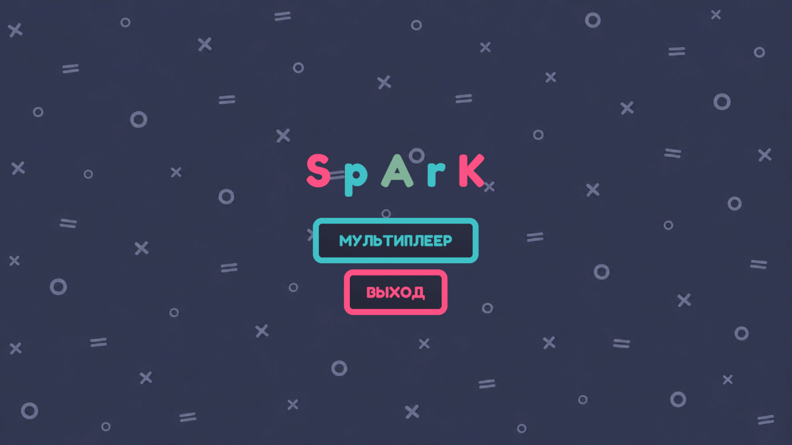
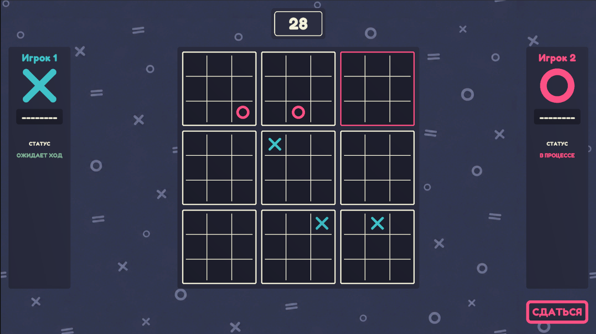

# Ultimate TicTacToe

**English** | [Русский](README.ru.md)


A multiplayer **Ultimate Tic-Tac-Toe** game built with Unity and Netcode for GameObjects.

The project started as a way to level up my Unity skills. Along the way I built several **standalone, reusable systems** (modal windows, inventory, save), each in its own assembly definition so it can be dropped into any other project.

<p align="center">
  
  
</p>

## About the game

Ultimate Tic-Tac-Toe is a 3×3 grid of 3×3 boards. Where you place a mark inside a small board decides which board your opponent must play next. Win three small boards in a row to win the game.

- Online 1v1 multiplayer
- Turn timer, player status panels, surrender button
- Lobby and matchmaking through Unity Sessions

## Highlights

| | |
|---|---|
| **Reusable systems** | Modal windows, Inventory and Save live in separate assembly definitions with no dependency on the game itself |
| **Async-first code** | UniTask + R3 for flows and reactive state instead of callbacks and coroutines |
| **Addressables** | Modal prefabs are loaded lazily by address and cached |
| **Online multiplayer** | Sessions for the lobby, Relay for connectivity, RPCs for game actions |
| **Clean structure** | Presentation, data and content are separated into dedicated folders |

## Project structure

```
Assets/
└── Spark/
    ├── Inventory/        # Standalone inventory system (own .asmdef)
    ├── Modal/            # Standalone modal window system (own .asmdef)
    ├── Save/             # Standalone save system (own .asmdef)
    └── TicTacToe/        # Everything specific to the game
        ├── Content/      # Sprites
        ├── Model/        # Data classes, enums, structs
        ├── Presenter/    # Presenters
        ├── View/         # Views
        └── UI/           # Screen views
```

> Ultimate TicTacToe uses only the **Modal** system. Inventory and Save are not used by the game; they are kept as independent modules for reuse in other projects.

## Reusable systems

### Modal system

A typed, async modal window service. A window declares its argument and result types, and the caller simply `await`s the result.

```csharp
public class ModalService : IDisposable
{
    public ModalService Register<TModal>(string address);

    public UniTask<ModalResult<TResult>> OpenAsync<TModal, TResult>()
        where TModal : ModalWindow<Unit, TResult>;

    public UniTask<ModalResult<TResult>> OpenAsync<TModal, TArgs, TResult>(TArgs args)
        where TModal : ModalWindow<TArgs, TResult>;
}
```

Usage (`ConfirmModal` here is an example window type):

```csharp
modalService
    .Register<ConfirmModal>("Modals/ConfirmModal")
    .Register<SettingsModal>("Modals/SettingsModal");

var result = await modalService.OpenAsync<ConfirmModal, ConfirmArgs, bool>(args);
```

What is worth looking at:

- **Typed contract.** `ModalWindow<TArgs, TResult>` makes arguments and results part of the type system, with no `object` casting.
- **`await` instead of callbacks.** Opening a window is a single awaited call that returns a `ModalResult<T>`.
- **Addressables with a handle cache.** A prefab is loaded on the first request and the handle is reused afterwards. All handles are released in `Dispose()`.
- **Deterministic lifetime.** The instance is created before the call and destroyed in `finally`, so the window is cleaned up even if an exception is thrown.
- **Fail fast.** An unregistered modal, or a prefab without the expected component, throws an `InvalidOperationException` with a clear message.
- **Fluent registration.** `Register<T>()` returns the service, so all windows are registered in one chain.

### Inventory system

Standalone inventory module in its own assembly definition. Not used by TicTacToe.

### Save system

Standalone save module in its own assembly definition. Not used by TicTacToe.

## Multiplayer

- **Netcode for GameObjects** for the networking layer
- **Unity Multiplayer Services (Sessions)** for creating and joining game lobbies
- **Relay** for connecting players without port forwarding
- **RPCs** for transmitting moves and game events

## Tech stack

| Area | Technology |
|---|---|
| Engine | Unity `6000.0.84f1`, Universal Render Pipeline 17.0.4 |
| Networking | Netcode for GameObjects 2.13.2, Unity Services Multiplayer 2.3.2 (Sessions, Relay) |
| Async | [UniTask](https://github.com/Cysharp/UniTask) |
| Reactive | [R3](https://github.com/Cysharp/R3) |
| DI | [VContainer](https://github.com/hadashiA/VContainer) 1.19.0 |
| Assets | Addressables 2.10.3 |
| Animation | [PrimeTween](https://github.com/KyryloKuzyk/PrimeTween) 1.4.11 |
| Input | Input System 1.20.0 |
| Packages | NuGetForUnity |

## Getting started

**Requirements:** Unity `6000.0.84f1`.

1. Clone the repository:
   ```bash
   git clone <repository-url>
   ```
2. Open the project in Unity Hub with the version above.
3. Link the project to Unity Gaming Services (**Project Settings → Services**) and enable **Relay** and **Multiplayer Sessions** in the Unity Dashboard. Online play requires this.
4. Open the main menu scene and press **Play**.

For player builds, build the Addressables content first (**Window → Asset Management → Addressables → Groups → Build**).

To test multiplayer locally, use **Multiplayer Play Mode** (Window → Multiplayer → Multiplayer Play Mode) to run two players from one editor.

## Status

The game is fully implemented and playable.
