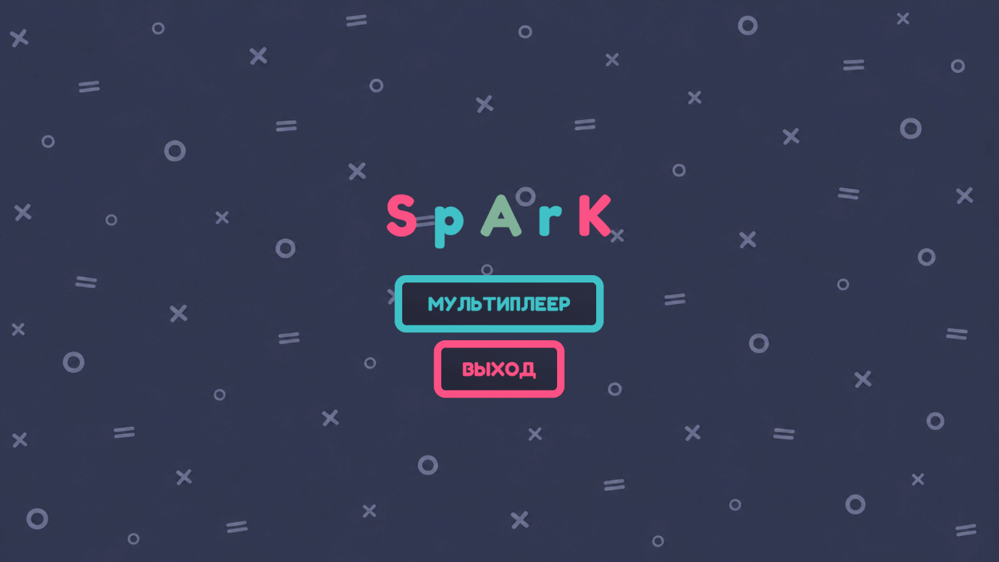
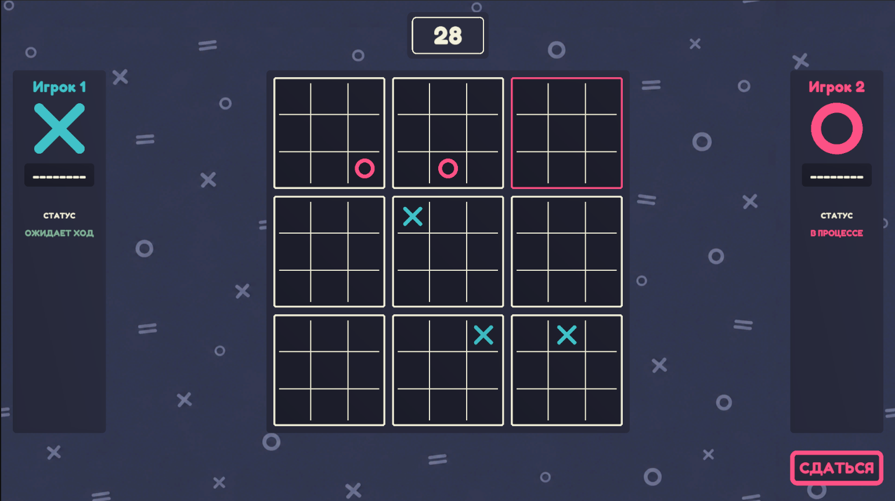

# Ultimate TicTacToe

[English](README.md) | **Русский**


Мультиплеерная игра **Ultimate Tic-Tac-Toe** на Unity с использованием Netcode for GameObjects.

Проект начинался как способ прокачать навыки в Unity. В процессе я написал несколько **самостоятельных переиспользуемых систем** (модальные окна, инвентарь, сохранение). Каждая находится в своей assembly definition и может быть перенесена в любой другой проект.

<p align="center">
  
  
</p>

## Об игре

Ultimate Tic-Tac-Toe: поле 3×3, где каждая клетка является отдельной доской 3×3. Клетка, в которую вы ставите знак на малой доске, определяет, на какой доске должен ходить соперник. Чтобы победить, нужно выиграть три малые доски подряд.

- Онлайн-мультиплеер 1 на 1
- Таймер хода, панели статусов игроков, кнопка «Сдаться»
- Лобби и подбор партии через Unity Sessions

## Основные особенности

| | |
|---|---|
| **Переиспользуемые системы** | Модальные окна, инвентарь и сохранение лежат в отдельных assembly definition и не зависят от самой игры |
| **Async-first код** | UniTask и R3 вместо колбэков и корутин |
| **Addressables** | Префабы модальных окон загружаются лениво по адресу и кэшируются |
| **Онлайн-мультиплеер** | Sessions для лобби, Relay для подключения, RPC для игровых действий |
| **Чистая структура** | Представление, данные и контент разделены по папкам |

## Структура проекта

```
Assets/
└── Spark/
    ├── Inventory/        # Самостоятельная система инвентаря (своя .asmdef)
    ├── Modal/            # Самостоятельная система модальных окон (своя .asmdef)
    ├── Save/             # Самостоятельная система сохранения (своя .asmdef)
    └── TicTacToe/        # Всё, что относится к игре
        ├── Content/      # Спрайты
        ├── Model/        # Файлы данных, enum, struct
        ├── Presenter/    # Презентеры
        ├── View/         # Представления
        └── UI/           # View экранов
```

> Ultimate TicTacToe использует только систему **Modal**. Инвентарь и сохранение в игре не задействованы: это независимые модули для повторного использования в других проектах.

## Переиспользуемые системы

### Система модальных окон

Типизированный асинхронный сервис модальных окон. Окно объявляет типы аргументов и результата, а вызывающий код просто делает `await`.

```csharp
public class ModalService : IDisposable
{
    public ModalService Register<TModal>(string address);

    public UniTask<ModalResult<TResult>> OpenAsync<TModal, TResult>()
        where TModal : ModalWindow<Unit, TResult>;

    public UniTask<ModalResult<TResult>> OpenAsync<TModal, TArgs, TResult>(TArgs args)
        where TModal : ModalWindow<TArgs, TResult>;
}
```

Пример использования (`ConfirmModal` здесь условное название окна):

```csharp
modalService
    .Register<ConfirmModal>("Modals/ConfirmModal")
    .Register<SettingsModal>("Modals/SettingsModal");

var result = await modalService.OpenAsync<ConfirmModal, ConfirmArgs, bool>(args);
```

На что стоит обратить внимание:

- **Типизированный контракт.** `ModalWindow<TArgs, TResult>` делает аргументы и результат частью системы типов, без приведения `object`.
- **`await` вместо колбэков.** Открытие окна — один awaited-вызов, возвращающий `ModalResult<T>`.
- **Addressables с кэшем хэндлов.** Префаб загружается при первом обращении, затем хэндл переиспользуется. Все хэндлы освобождаются в `Dispose()`.
- **Предсказуемое время жизни.** Экземпляр создаётся перед вызовом и уничтожается в `finally`, поэтому окно убирается даже при исключении.
- **Fail fast.** Незарегистрированное окно или префаб без нужного компонента выбрасывают `InvalidOperationException` с понятным сообщением.
- **Fluent-регистрация.** `Register<T>()` возвращает сервис, поэтому все окна регистрируются одной цепочкой.

### Система инвентаря

Самостоятельный модуль инвентаря в собственной assembly definition. В TicTacToe не используется.

### Система сохранения

Самостоятельный модуль сохранения в собственной assembly definition. В TicTacToe не используется.

## Мультиплеер

- **Netcode for GameObjects** для сетевого слоя
- **Unity Multiplayer Services (Sessions)** для создания лобби и подключения к ним
- **Relay** для соединения игроков без проброса портов
- **RPC** для передачи ходов и игровых событий

## Технологии

| Область | Технология |
|---|---|
| Движок | Unity `6000.0.84f1`, Universal Render Pipeline 17.0.4 |
| Сеть | Netcode for GameObjects 2.13.2, Unity Services Multiplayer 2.3.2 (Sessions, Relay) |
| Async | [UniTask](https://github.com/Cysharp/UniTask) |
| Reactive | [R3](https://github.com/Cysharp/R3) |
| DI | [VContainer](https://github.com/hadashiA/VContainer) 1.19.0 |
| Ассеты | Addressables 2.10.3 |
| Анимации | [PrimeTween](https://github.com/KyryloKuzyk/PrimeTween) 1.4.11 |
| Ввод | Input System 1.20.0 |
| Пакеты | NuGetForUnity |

## Запуск

**Требования:** Unity `6000.0.84f1`.

1. Клонируйте репозиторий:
   ```bash
   git clone <repository-url>
   ```
2. Откройте проект в Unity Hub указанной версией.
3. Привяжите проект к Unity Gaming Services (**Project Settings → Services**) и включите **Relay** и **Multiplayer Sessions** в Unity Dashboard. Для онлайн-игры это обязательно.
4. Откройте сцену главного меню и нажмите **Play**.

Для сборки под платформу сначала соберите контент Addressables (**Window → Asset Management → Addressables → Groups → Build**).

Для локальной проверки мультиплеера используйте **Multiplayer Play Mode** (Window → Multiplayer → Multiplayer Play Mode), чтобы запустить двух игроков из одного редактора.

## Статус

Игра полностью реализована и играбельна.
